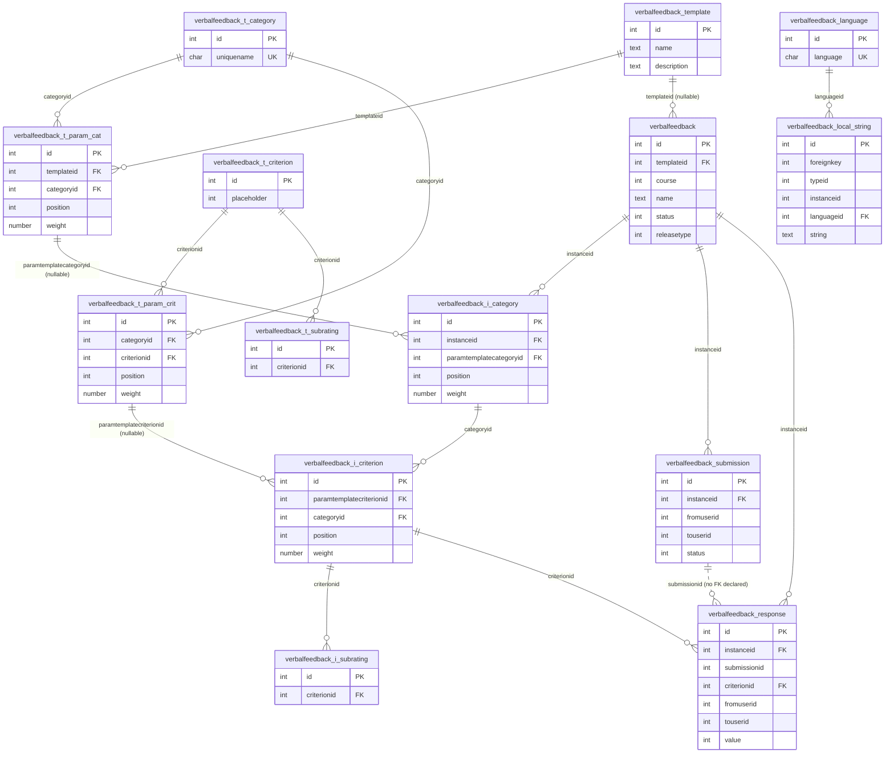

# Verbal feedback — database schema relations

Generated from [install.xml](install.xml). The design has two mirrored halves — a
**template** side (reusable definitions) and an **instance** side (the per-activity copy
created from a template) — plus the response-collection tables and a localisation subsystem.

## Entity-relationship diagram

## Relations in detail

### Template side (reusable definitions)

| Child table | FK field | → Parent table | Meaning |
|---|---|---|---|
| `verbalfeedback_t_param_cat` | `templateid` | `verbalfeedback_template` | a template is made of N parametrised categories (with `position` + `weight`) |
| `verbalfeedback_t_param_cat` | `categoryid` | `verbalfeedback_t_category` | each links to a reusable category definition |
| `verbalfeedback_t_param_crit` | `categoryid` | `verbalfeedback_t_category` | a category holds N parametrised criteria (with `position` + `weight`) |
| `verbalfeedback_t_param_crit` | `criterionid` | `verbalfeedback_t_criterion` | each links to a reusable criterion definition |
| `verbalfeedback_t_subrating` | `criterionid` | `verbalfeedback_t_criterion` | a criterion has N subratings |

### Instance side (built by copying a template; FKs point back to the parametrised template rows)

| Child table | FK field | → Parent table | Meaning |
|---|---|---|---|
| `verbalfeedback` | `templateid` | `verbalfeedback_template` | the activity records which template it came from (nullable) |
| `verbalfeedback_i_category` | `instanceid` | `verbalfeedback` | categories belonging to this activity |
| `verbalfeedback_i_category` | `paramtemplatecategoryid` | `verbalfeedback_t_param_cat` | provenance: the template category it was copied from (nullable) |
| `verbalfeedback_i_criterion` | `categoryid` | `verbalfeedback_i_category` | criteria within an instance category |
| `verbalfeedback_i_criterion` | `paramtemplatecriterionid` | `verbalfeedback_t_param_crit` | provenance: the template criterion it was copied from (nullable) |
| `verbalfeedback_i_subrating` | `criterionid` | `verbalfeedback_i_criterion` | subratings of an instance criterion |

### Response collection

| Child table | FK field | → Parent table |
|---|---|---|
| `verbalfeedback_submission` | `instanceid` | `verbalfeedback` |
| `verbalfeedback_response` | `instanceid` | `verbalfeedback` |
| `verbalfeedback_response` | `criterionid` | `verbalfeedback_i_criterion` |
| `verbalfeedback_response` | `submissionid` | points at `verbalfeedback_submission.id` but declared only as a comment — no `<KEY>` foreign key |

### Localisation (orthogonal subsystem — stores translatable text for any of the above)

`verbalfeedback_local_string` is a **polymorphic** table: `foreignkey` + `typeid` identify
*which* record (a category, criterion, subrating, template name, etc.) the string translates —
there is no hard FK to those tables, only the `(foreignkey, typeid)` index. Only `languageid`
has a real declared foreign key (→ `verbalfeedback_language`).

## Key takeaways

- **Two parallel hierarchies.** `t_*` tables define reusable content; `i_*` tables are the
  instantiated per-activity copy. The flow `template → category → criterion → subrating` is
  mirrored on both sides.
- **The `param` tables are join/placement tables** — `t_param_cat` places a category into a
  template, and `t_param_crit` places a criterion into a category, each carrying `position`
  and `weight`. This lets the same category/criterion definition be reused across templates
  with different weights.
- **Instance rows keep provenance** back to the template `param` rows (`paramtemplate*id`),
  but those are nullable, so an instance can diverge from or outlive its template.
- Two soft spots worth noting: `verbalfeedback_response.submissionid` is a logical FK with no
  declared key, and the whole localisation layer is polymorphic (no enforced FKs to the
  translated entities).
